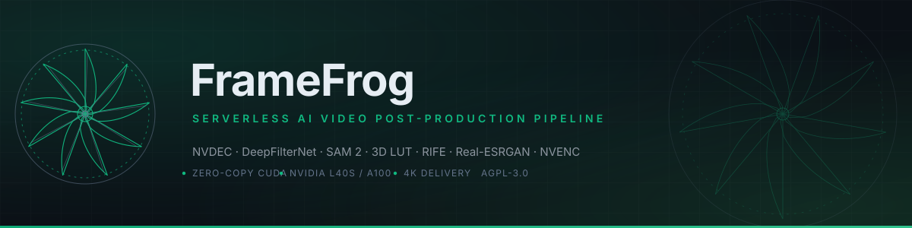

<p align="center">
  
</p>

<p align="center">
  <a href="https://framefrog.me"></a>
  <a href="https://github.com/framefrog-ai/framefrog-pipeline/actions/workflows/ci.yml"></a>
  <a href="https://github.com/framefrog-ai/.github/blob/main/LICENSE"></a>
  <a href="mailto:contact@framefrog.me"></a>
</p>

<h3 align="center">Video post-production that runs itself — on serverless GPUs.</h3>

<p align="center">
  FrameFrog is an AI-native cloud post-production pipeline. Decode, denoise, rotoscope, grade, interpolate, upscale and encode
  broadcast-ready masters through one API — with frames staying in device memory the whole way.
</p>

---

## The pipeline

```text
NVDEC  →  DeepFilterNet  →  SAM 2  →  3D LUT  →  RIFE  →  Real-ESRGAN  →  NVENC
decode     neural audio      auto       look      frame      4K detail      hardware
           denoise           mattes     engine    interpolation              encode
```

- **Zero-copy CUDA** — frames are decoded into CUDA surfaces and consumed in place by the models and the encoder. No host round-trips between stages.
- **Per-shot fan-out** — scenes split at cuts, grade/interpolate/upscale in parallel workers, stitch with continuous audio. File queue locally, SQS for a pool.
- **Honest manifests** — every job records stage timings, model graphs, ONNX/TensorRT providers, the chosen encoder, fallbacks and GPU-second cost.
- **Optional everything** — models degrade to FFmpeg fallbacks; NVENC degrades to libx264; the pipeline still runs on a CPU box.

## GPU stack

| Layer | Implementation |
|---|---|
| Decode / encode | NVDEC · NVENC (h264/hevc), libx264 fallback |
| Audio | DeepFilterNet3, FFmpeg spectral fallback, −16 LUFS |
| Mattes | SAM 2.1 video predictor, automatic largest-object or prompted seed |
| Grade | 3D LUT engine (`.cube`), blendable strength, SHA-256 fingerprints |
| Motion | RIFE v4.9 ONNX (CUDA/CPU) or FFmpeg `minterpolate` |
| Upscale | TensorRT engine contract, Real-ESRGAN x4, Lanczos fallback |
| Orchestration | Stateless stages · file/SQS queue · webhooks · signed URLs |

Reference hosts: **NVIDIA L40S** for the full decode→encode chain, **A100 80GB** for SAM 2 / RIFE / TensorRT compute with encode on an NVENC-capable node. Setup and troubleshooting live in [docs/nvidia-host.md](https://github.com/framefrog-ai/framefrog-pipeline/blob/main/docs/nvidia-host.md).

## Repositories

| Repository | What it is |
|---|---|
| [framefrog-pipeline](https://github.com/framefrog-ai/framefrog-pipeline) | The engine: Python package, FastAPI surface, stages, queue fan-out, CI |
| [framefrog.github.io](https://github.com/framefrog-ai/framefrog.github.io) | [framefrog.me](https://framefrog.me) — product site and live demos |

## Start here

```bash
git clone git@github.com:framefrog-ai/framefrog-pipeline.git
cd framefrog-pipeline
pip install -r requirements.txt
python demo.py                      # end-to-end on synthetic footage
python -m framefrog.gpu_check       # verify NVENC / TensorRT / SAM 2 on a GPU host
```

- Product and API overview: [framefrog.me](https://framefrog.me)
- Studio work and access: [contact@framefrog.me](mailto:contact@framefrog.me)
- License: [AGPL-3.0](https://github.com/framefrog-ai/.github/blob/main/LICENSE) — network services must offer their source (section 13).

<p align="center"><sub>FrameFrog · framefrog.me · #0D1117 / #10B981</sub></p>
